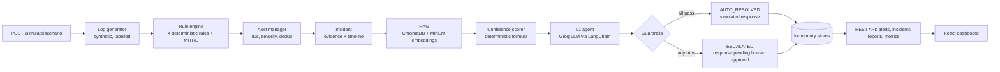

# AI SOC Simulator

A portfolio project showing how AI can take repetitive **L1 alert triage** off a
Security Operations Center analyst, while uncertain or high-risk decisions stay
with a human.

The simulator generates synthetic attack logs, detects them with deterministic
rules, turns detections into alerts and incidents, looks up similar historical
incidents (RAG), scores confidence, and lets an LLM-backed L1 agent propose
"auto-resolve" or "escalate". Deterministic guardrails have the final say. Every
response action is **simulated**, and every step lands in an audit timeline
shown on a React dashboard.

> **Safety:** all logs are synthetic, all IPs come from RFC 5737 documentation
> ranges, and response actions are records only. Nothing in this project
> performs real containment or touches real infrastructure.

## Architecture



**Why this design:** detection stays deterministic and explainable. The same
logs always produce the same alerts, and every alert names the rule, the MITRE
ATT&CK technique and the exact evidence. AI is used only for triage on top of
that, and it can only make an outcome *more* cautious. A guardrail can turn the
LLM's `AUTO_RESOLVE` into `ESCALATE`, never the reverse.

### What each stage does

| Stage | Module | What happens |
|---|---|---|
| Log generation | `backend/simulation/log_generator.py` | Deterministic benign + malicious `SecurityLog` events per scenario; each event carries `metadata.ground_truth` and `metadata.scenario`. |
| Detection | `backend/detection/` | `rule_engine.detect()` runs 4 rules; MITRE mapping comes from `mitre_mapping.py`. |
| Alerts | `backend/alerts/alert_manager.py` | `ALERT-NNNN` IDs, severity normalization, dedup of the same rule on the same evidence while the earlier alert is still open. |
| Incidents | `backend/app/models/incident.py` | One incident per alert, seeded with evidence and the first two timeline entries. |
| RAG | `backend/rag/` | Indexes `data/incidents/synthetic_pairs.jsonl` into a persistent ChromaDB collection; retrieves the top 3 similar historical incidents. |
| Confidence | `backend/triage/confidence.py` | `0.60·similarity + 0.25·technique agreement + 0.15·severity agreement`, times a severity caution factor (LOW 1.00 … CRITICAL 0.75). Every factor is written to the timeline. |
| L1 agent | `backend/agent/l1_analyst.py` | Sends incident facts to Groq (`llama-3.3-70b-versatile` by default), parses a JSON verdict, then applies guardrails. |
| Response | `backend/agent/response_simulator.py` | Fixed catalog of 8 actions (`BLOCK_IP`, `KILL_PROCESS`, `MONITOR`, …). Produces a record with `simulated: true`; status `SIMULATED` when auto-resolved, `PENDING_HUMAN_APPROVAL` when escalated. |
| Orchestration | `backend/app/services/simulation_pipeline.py` | `run_scenario()` wires every stage above in order. |
| Reports | `backend/reports/report_generator.py` | JSON and Markdown reports built from the stored incident. |
| API | `backend/app/api/` | FastAPI routers (see [API](#api)). |
| Dashboard | `frontend/src/` | React + TypeScript + Recharts; stat cards, alert feed, severity chart, incident detail with timeline and report. |

### Guardrails (any one forces escalation)

| Guardrail | Trigger |
|---|---|
| `llm_unavailable` | no `GROQ_API_KEY` configured |
| `llm_error` | provider error or timeout (20 s, at most one retry) |
| `llm_output_invalid` | reply is not valid JSON matching the verdict schema |
| `unknown_action` | recommended action is not in the simulated catalog |
| `confidence_missing` / `confidence_below_threshold` | confidence absent or below 0.85 |
| `high_severity` / `critical_severity` | rule severity HIGH or CRITICAL |
| `rag_unavailable` | knowledge base not indexed, or the search itself failed |
| `no_historical_match` | retrieval returned nothing |

An `ESCALATE` from the LLM is always honoured.

### Audit timeline

Each incident's timeline is written in this order:

`ALERT_CREATED` → `DETECTION_RULE_TRIGGERED` → `RAG_SEARCH_PERFORMED` →
`CONFIDENCE_SCORED` → `AGENT_DECISION` → `RESPONSE_ACTION` →
`INCIDENT_CLOSED` (auto-resolved) or `ESCALATED`.

`RAG_SEARCH_PERFORMED` records the search status (`ok`, `no_matches`,
`unavailable`, `error`), so a missing knowledge base is visible instead of
looking like "nothing similar happened before".

## Features

Each of these was checked in the code and is covered by tests in `backend/tests/`.

- **4 attack scenarios:** `brute_force`, `malicious_ip`, `suspicious_powershell`, `suspicious_command`.
- **4 deterministic rules with MITRE ATT&CK mapping:**

  | Rule | Scenario | Severity | Tactic / Technique |
  |---|---|---|---|
  | RULE-001 Brute-Force | `brute_force` | HIGH | Credential Access / T1110 |
  | RULE-002 Known Malicious IP | `malicious_ip` | HIGH | Command and Control / T1071 |
  | RULE-003 Suspicious PowerShell | `suspicious_powershell` | MEDIUM | Execution / T1059.001 |
  | RULE-004 Suspicious Command | `suspicious_command` | MEDIUM | Execution / T1059 |

- **Alert lifecycle and deduplication:** statuses `NEW`, `AUTO_RESOLVED`, `ESCALATED` are used today. `TRIAGED` and `CLOSED` exist in the model but no code path sets them yet.
- **Historical incident retrieval:** ChromaDB, cosine similarity, `all-MiniLM-L6-v2` embeddings (local, no API key).
- **Deterministic confidence scoring** with a written rationale.
- **AI L1 triage** with structured output and deterministic guardrails.
- **Response simulation** from a fixed catalog; nothing is executed.
- **Incident reports** in JSON and Markdown.
- **Metrics** computed from stored state only.
- **Dashboard** with scenario buttons, 5-second auto-refresh, and warning banners when the LLM key or the knowledge base is missing.

## Technology stack

From `requirements.txt` and `frontend/package.json`:

- **Backend:** Python 3.11+ (this audit ran on 3.13), FastAPI, Uvicorn, Pydantic v2, pydantic-settings
- **RAG:** ChromaDB, sentence-transformers (`all-MiniLM-L6-v2`), NumPy
- **LLM:** LangChain Core + `langchain-groq` (Groq API)
- **Frontend:** React 18, TypeScript, Vite 6, Recharts
- **Tests:** pytest, httpx (FastAPI `TestClient`)

Storage is in memory: alerts and incidents reset when the API restarts. Only
the ChromaDB index persists, in `data/vectorstore/`.

## Folder structure

```
backend/
  app/
    main.py                     FastAPI app and routers
    config.py                   settings from .env (pydantic-settings)
    api/                        health, alerts, incidents, simulate, metrics
    models/                     SecurityLog, Alert, Incident + AuditEntry, incident store
    services/simulation_pipeline.py   end-to-end orchestration
  simulation/log_generator.py   synthetic log generator (also a CLI)
  detection/                    rule engine, rules/, MITRE registry
  alerts/alert_manager.py       alert creation, dedup, state
  rag/                          embeddings, ChromaDB store, retriever, dataset loader
  triage/confidence.py          deterministic confidence scorer
  agent/                        L1 analyst, verdict schemas, response simulator
  reports/report_generator.py   JSON + Markdown incident reports
  tests/                        pytest suite
frontend/src/                   React dashboard
data/incidents/synthetic_pairs.jsonl   historical incidents for RAG (5 synthetic records)
docs/                           design notes, roadmap, workflow audit
```

## Setup

Prerequisites: Python 3.11+, Node.js 18+ and npm. The first simulation
downloads the embedding model (about 90 MB) from huggingface.co, so that run
needs internet access.

### Backend

From the repository root:

```bash
python -m venv .venv
source .venv/bin/activate          # Windows PowerShell: .\.venv\Scripts\Activate.ps1
pip install -r requirements.txt
cp .env.example .env               # Windows: Copy-Item .env.example .env
```

Edit `.env`:

| Variable | Required | Purpose |
|---|---|---|
| `GROQ_API_KEY` | No | Enables the LLM. Without it the pipeline still runs, and every incident is escalated with `llm_unavailable`. |
| `LLM_MODEL` | No | Groq model name (default `llama-3.3-70b-versatile`). |
| `VECTOR_STORE_PATH` | No | ChromaDB directory (default `data/vectorstore`, relative to where you start the API). |

Start the API (from the repository root):

```bash
uvicorn app.main:app --reload --app-dir backend
```

- Health: <http://127.0.0.1:8000/health>. It reports `llm_configured` and `rag.ready`/`rag.error`.
- Interactive API docs: <http://127.0.0.1:8000/docs>

### Dashboard

In a second terminal:

```bash
cd frontend
npm install
npm run dev
```

Open <http://127.0.0.1:5173>. The Vite dev server proxies API paths to port 8000.
`npm run build` type-checks and builds a production bundle.

## Running simulations

From the dashboard, click **Run All Scenarios** or one scenario button. The
alert feed, stat cards and chart refresh; click an alert to see its incident,
evidence, historical matches, confidence rationale, agent decision,
guardrails, timeline and report.

From the API:

```bash
curl -X POST http://127.0.0.1:8000/simulate/brute_force   # one scenario
curl -X POST http://127.0.0.1:8000/simulate               # all four
curl http://127.0.0.1:8000/incidents
curl "http://127.0.0.1:8000/incidents/INC-0001/report?format=text"
curl http://127.0.0.1:8000/metrics
```

Running the same scenario again creates no new alerts while the earlier ones
are still escalated (dedup). Restart the API to start fresh.

To write raw logs to a file without running the pipeline (from `backend/`):

```bash
python -m simulation.log_generator --scenario brute_force --out ../data/logs/brute_force.ndjson
python -m simulation.log_generator --out ../data/logs/all.ndjson    # all scenarios
```

The same `--seed` always produces identical logs.

### API

| Endpoint | Purpose |
|---|---|
| `GET /health` | liveness, LLM and RAG readiness |
| `POST /simulate` | run every scenario once |
| `POST /simulate/{scenario}` | run one scenario (404 for unknown names) |
| `GET /alerts` | alert feed; optional `severity`, `status` |
| `GET /alerts/{id}` | one alert |
| `GET /incidents` | incidents; optional `status`, `technique` |
| `GET /incidents/{id}` | one incident with timeline |
| `GET /incidents/{id}/report?format=json\|text` | incident report |
| `GET /metrics` | counts from stored state; `detection_rate` is the share of ground-truth malicious log events that appear in some detection's evidence |

## Testing

```bash
pytest                                              # whole suite, from the repo root
pytest backend/tests/test_workflow_integration.py   # end-to-end workflow and failure paths
pytest backend/tests/test_detection_rate.py -s      # detection-rate evaluation table
pytest backend/tests/test_retrieval.py -s           # RAG retrieval-accuracy evaluation (real model)
```

Tests never call a real LLM and never touch `data/vectorstore`: each test gets
its own temporary ChromaDB directory. Most tests use a stand-in hashed
embedding so they run offline. Tests marked `real_embeddings`
(`test_retrieval.py`) need the real model and are **skipped with
"MANUAL VERIFICATION REQUIRED"** when it cannot be downloaded.

## Current status and known limitations

**Works:** the full pipeline for all four scenarios, from API request to final
incident state, report and metrics. Failure handling covers a missing API key,
LLM errors, invalid LLM output, a missing knowledge base, embedding failures,
empty retrieval and unknown scenarios. See
[docs/simulation-workflow-audit.md](docs/simulation-workflow-audit.md) for
stage-by-stage evidence.

**Limitations:**

- The historical knowledge base has only **5** synthetic incidents. Retrieval quality claims should be read with that in mind.
- Retrieval accuracy and real similarity values with the real embedding model have **not been verified** in the current development environment, which cannot download the model. Run `pytest backend/tests/test_retrieval.py -s` locally.
- Live Groq calls have not been verified. LLM behaviour is tested with fake models only.
- Because HIGH and CRITICAL always escalate and the threshold is 0.85, only MEDIUM/LOW incidents with a top similarity of roughly 0.83 or more can auto-resolve. With the stand-in embedding, similarities are about 0.2–0.5, so everything escalates. Real-model values still need checking.
- State is in memory and is lost on restart. There is no endpoint to reset state, or for a human to approve or close an escalated incident.
- No Docker, Compose, CI, linting or type-check configuration yet.

The prioritized plan is in [docs/implementation-roadmap.md](docs/implementation-roadmap.md).

## Docs

- [docs/simulation-workflow-audit.md](docs/simulation-workflow-audit.md): stage-by-stage verification
- [docs/implementation-roadmap.md](docs/implementation-roadmap.md): what's next, by priority
- [docs/detection-rules.md](docs/detection-rules.md): detection layer design and contract
- [docs/log-schema.md](docs/log-schema.md): normalized `SecurityLog` schema
